# Contributing

[README.md](README.md) explains what each file *is*; this file helps you get started and understand how to contribute.

---

## 0. Before you start

Two things the Quickstart assumes you already have: `uv` and an exisitng SSH key.
Otherwise, see:
- [Astral's docs](https://docs.astral.sh/uv/getting-started/installation/) on how to install `uv`.
- [GitHub's documentation](https://docs.github.com/en/authentication/connecting-to-github-with-ssh/generating-a-new-ssh-key-and-adding-it-to-the-ssh-agent#generating-a-new-ssh-key) on how to generate a SSH key and [add it to your account](https://docs.github.com/en/authentication/connecting-to-github-with-ssh/generating-a-new-ssh-key-and-adding-it-to-the-ssh-agent#generating-a-new-ssh-key).

## 1. Setup your local copy

Clone the repo:
```bash
git clone git@github.com:JoshuaGloor/dss5105-capstone-project.git
```
`cd` into the directory:

```bash
cd dss5105-capstone-project
```
and do the necessary setup:
```
uv sync --all-groups         # installs everything into .venv
uv run pre-commit install    # sets up the commit-time checks
```

`uv sync` reads `uv.lock` and gives you byte-identical packages to everyone
else. It also installs the right Python, so you don't need to have 3.12 already.

**Don't skip `pre-commit install`.** Without it the checks only run in CI, and
you find out your code needed formatting after you've opened a PR rather than
before.

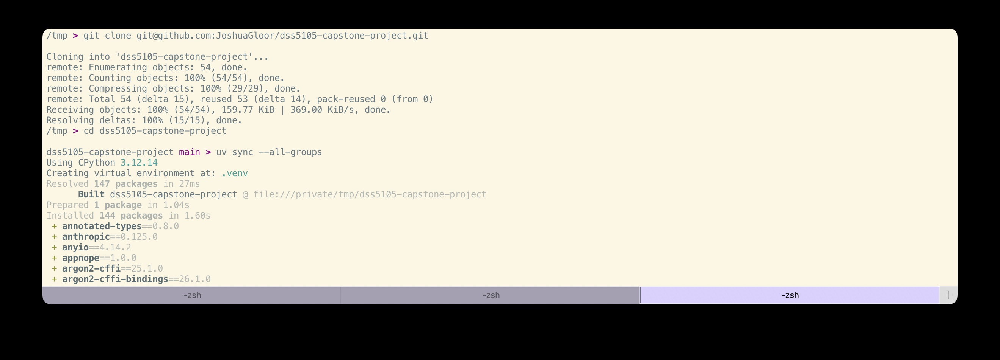
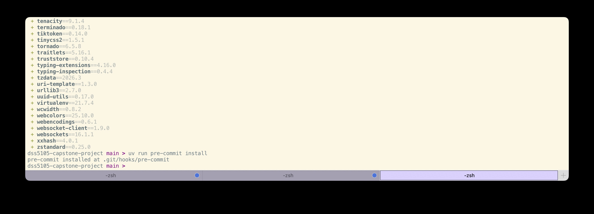

## 2. Add your API key

1. Create a key at [console.anthropic.com](https://console.anthropic.com)
   (or [platform.openai.com](https://platform.openai.com) if you'd rather use
   OpenAI).
2. **Recommended to set a monthly spend limit before your first run.**
3. Copy the template, paste your key in and specify the model you want to use:

```bash
cp .env.example .env
```

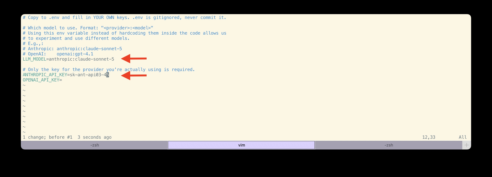

## 3. Run the existing tests

```bash
uv run pytest
```

As of the time of this writing, you should see `1 passed, 1 deselected`. The deselected one is the `live` test,
which really calls the API and costs money, so it's skipped unless you ask for
it by name.

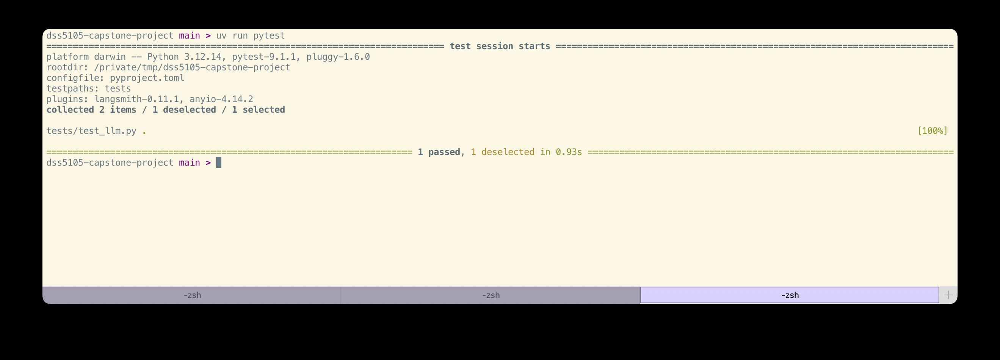

## 4. Every change after that

`main` is protected: no direct pushes. Every change goes through a pull request.

We demonstrate this using an example which you can follow along and shows whether your setup is correct.

### Branch and open notebook in your favourite editor

```bash
# Modern syntax; see `man git-switch`
git switch -c your-name/short-description
```

We use VS Code in this example:
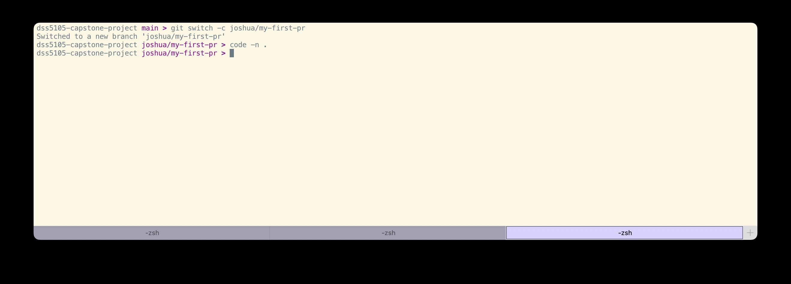

### Open `notebook/setup_check.py` using jupytext

For this, you need the [jupytext extension](https://marketplace.visualstudio.com/items?itemName=congyiwu.vscode-jupytext) as explained in the [README section](README.md#61-how-to-use-jupytext).

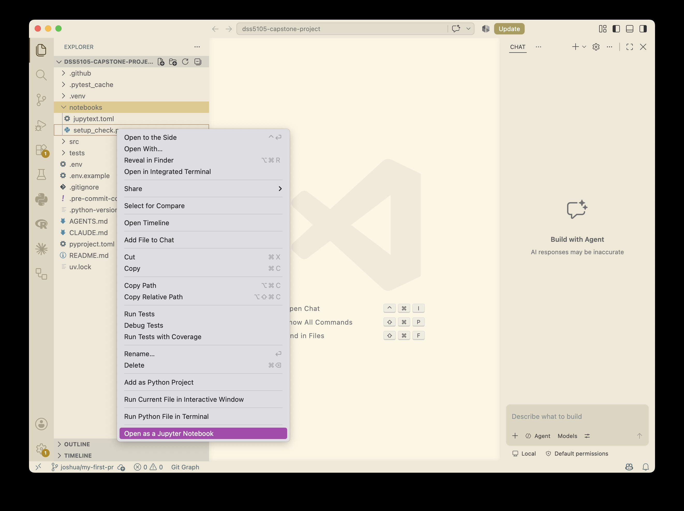

Alternatively, launch `jupyter lab` instead of VS Code:

```bash
uv run jupyter lab
```

and then open the notebook:

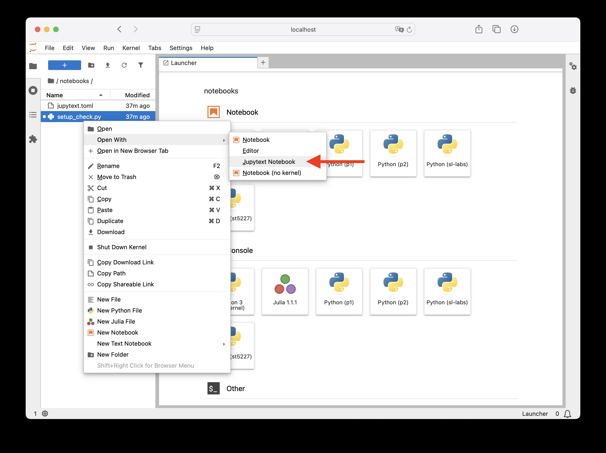

### Select the projects `.venv` kernel

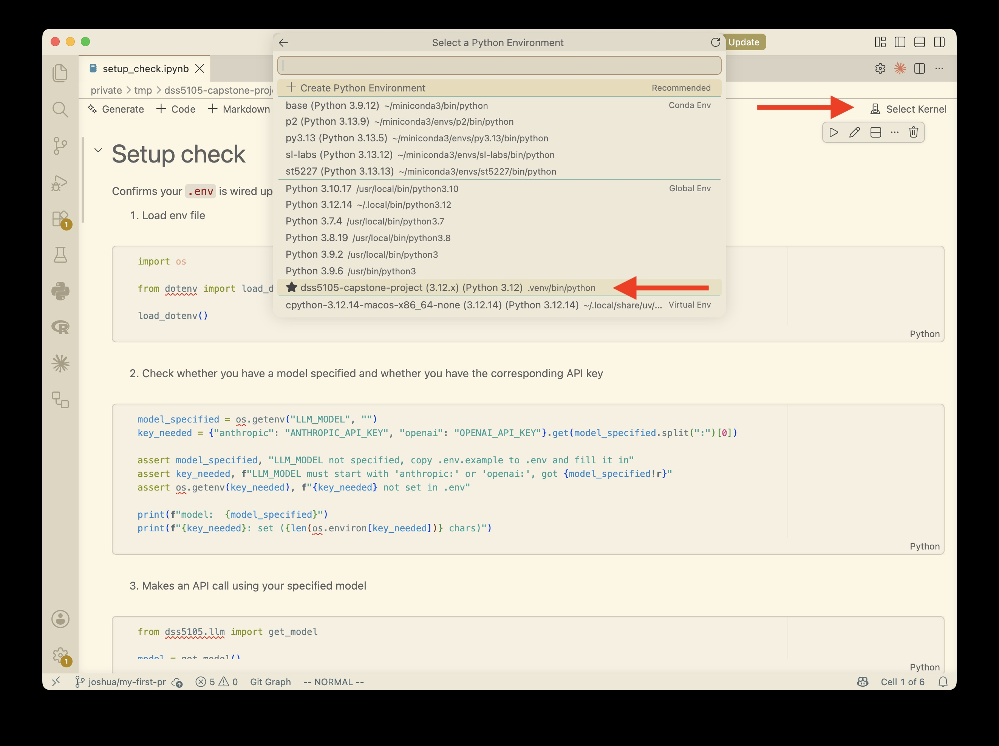

### Run the notebook to see whether your setup and API token works

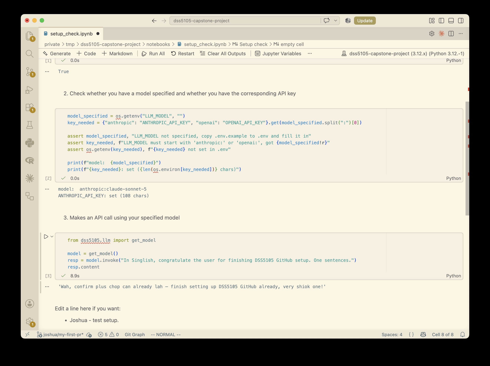

If you want, you can edit the last markdown line to cause a diff and raise a PR to try it out.

### Commit change

```bash
git add notebooks/setup_check.py # Only commit .py, not .ipynb.
git commit -m "Test PR and setup"
```

**If the commit is rejected, that's normal.** The hooks reformat your code and
stop the commit so you can see what changed. Look at the diff, then commit
again as shown in the screenshot:

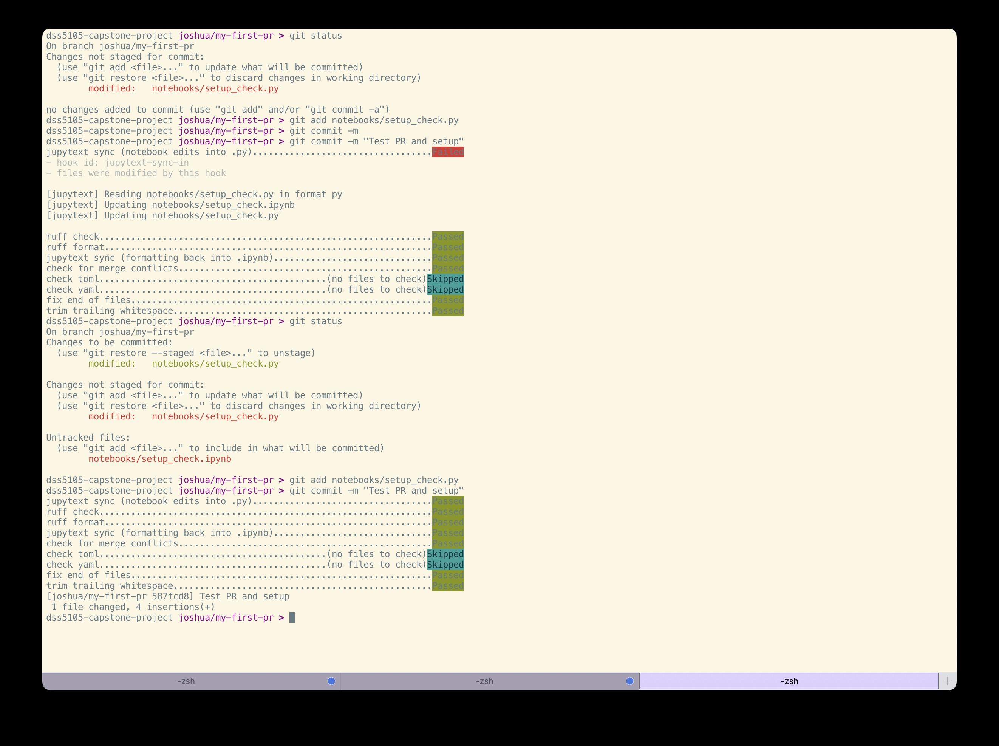

### Push and open a PR

```bash
git push origin your-name/short-description
```

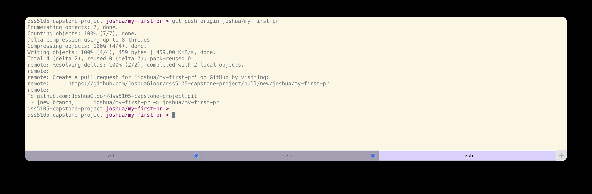

GitHub prints a link to open the PR. Or use the banner on the repo page.

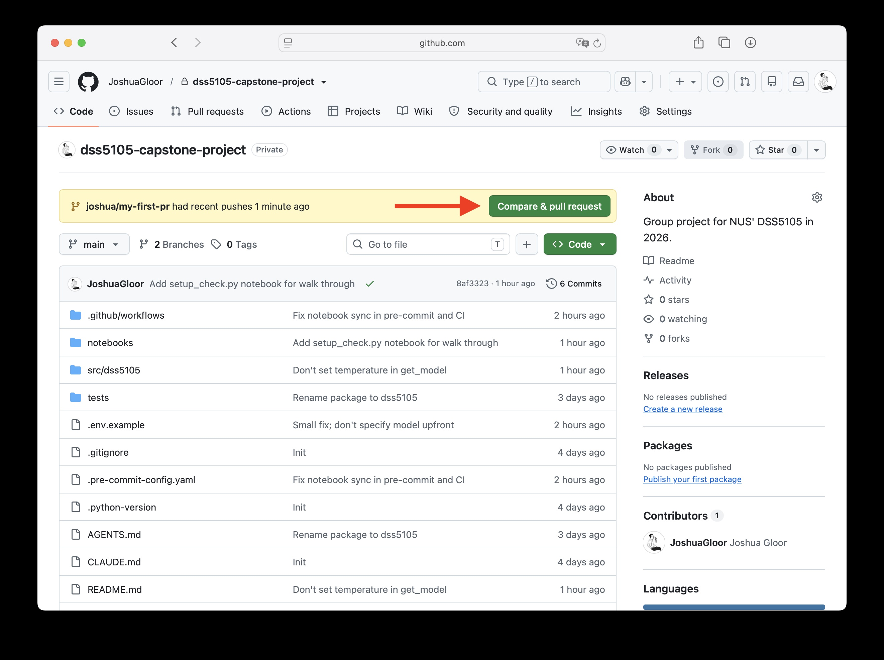

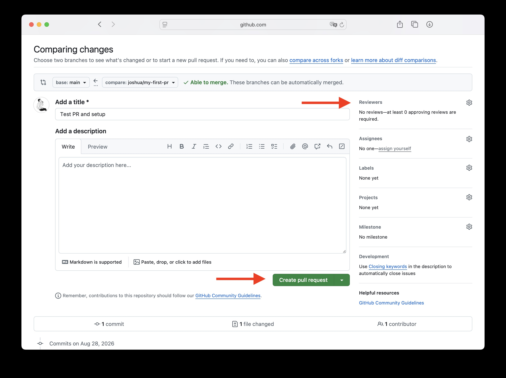

Some checks will run. Assuming they passed and you get at least one other team member to approve your PR, you can merge all your commits into `main` or squash them and merge a single commit:

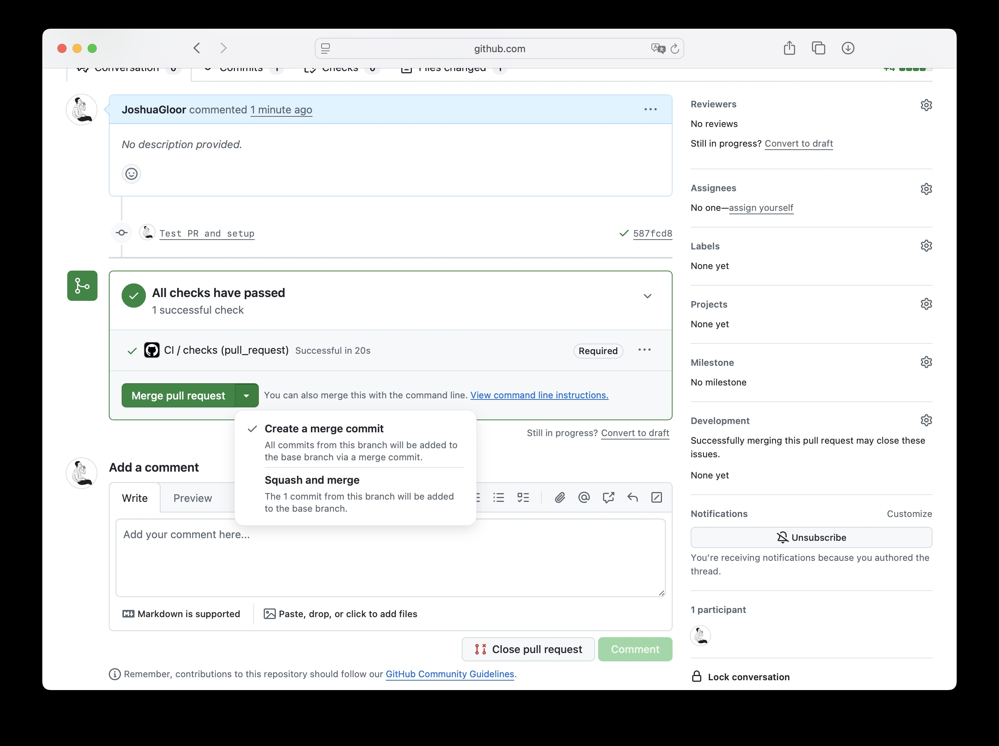

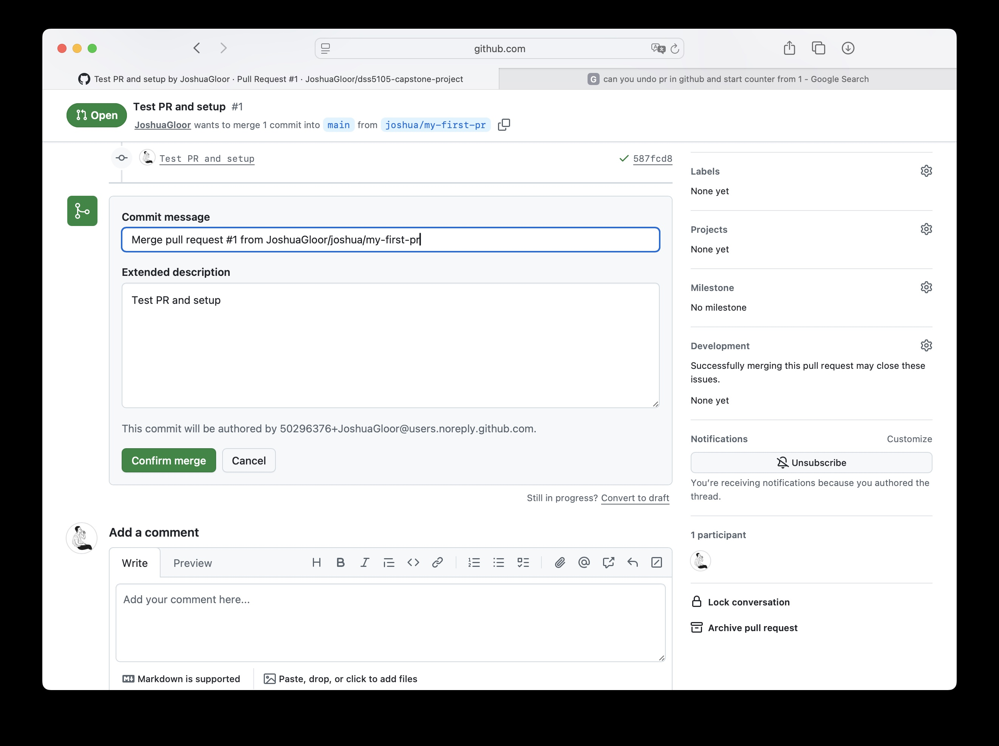

Then, you can delete the branch afterwards:

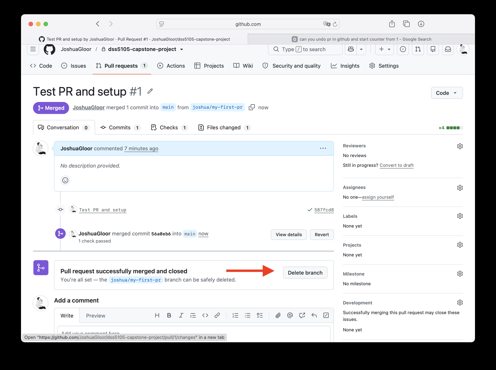

### Clean up local repo

Then, on your local, you can switch back to `main`, `pull`, and delete the branch you don't need anymore:

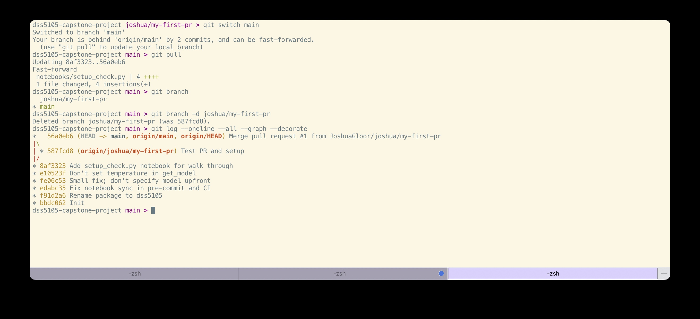

And you're done.
