# Contributing

[README.md](README.md) explains what each file *is*; this file helps you get started and understand how to contribute.

---

## 0. Before you start

Two things the Quickstart assumes you already have: `uv` and an exisitng SSH key.
Otherwise, see:
- [Astral's docs](https://docs.astral.sh/uv/getting-started/installation/) on how to install `uv`.
- [GitHub's documentation](https://docs.github.com/en/authentication/connecting-to-github-with-ssh/generating-a-new-ssh-key-and-adding-it-to-the-ssh-agent#generating-a-new-ssh-key) on how to generate a SSH key and [add it to your account](https://docs.github.com/en/authentication/connecting-to-github-with-ssh/generating-a-new-ssh-key-and-adding-it-to-the-ssh-agent#generating-a-new-ssh-key).

## 1. Setup your local copy

Clone the repo:
```bash
git clone git@github.com:JoshuaGloor/dss5105-capstone-project.git
```
`cd` into the directory:

```bash
cd dss5105-capstone-project
```
and do the necessary setup:
```
uv sync --all-groups         # installs everything into .venv
uv run pre-commit install    # sets up the commit-time checks
```

`uv sync` reads `uv.lock` and gives you byte-identical packages to everyone
else. It also installs the right Python, so you don't need to have 3.12 already.

**Don't skip `pre-commit install`.** Without it the checks only run in CI, and
you find out your code needed formatting after you've opened a PR rather than
before.

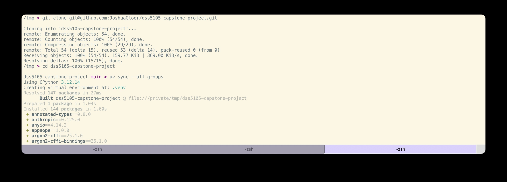
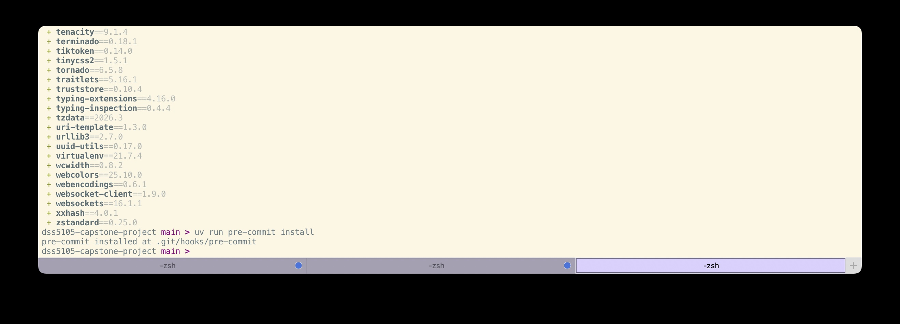

## 2. Add your API key

1. Create a key at [console.anthropic.com](https://console.anthropic.com)
   (or [platform.openai.com](https://platform.openai.com) if you'd rather use
   OpenAI).
2. **Recommended to set a monthly spend limit before your first run.**
3. Copy the template, paste your key in and specify the model you want to use:

```bash
cp .env.example .env
```

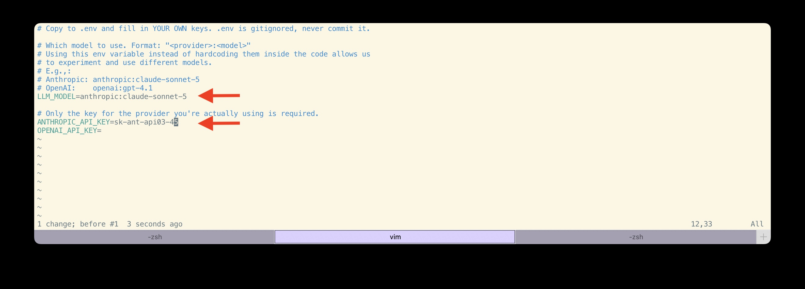

## 3. Run the existing tests

```bash
uv run pytest
```

As of the time of this writing, you should see `777 passed, 1 deselected`. The deselected one is the `live` test,
which really calls the API and costs money, so it's skipped unless you ask for
it by name.

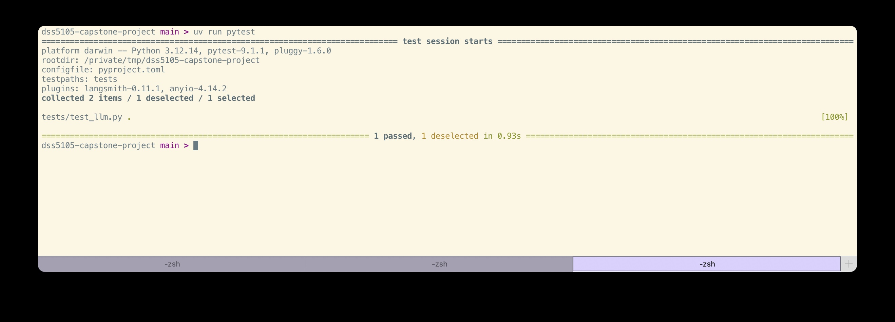

## 4. Every change after that

`main` is protected: no direct pushes. Every change goes through a pull request.

We demonstrate this using an example which you can follow along and shows whether your setup is correct.

### Branch and open notebook in your favourite editor

```bash
# Modern syntax; see `man git-switch`
git switch -c your-name/short-description
```

We use VS Code in this example:
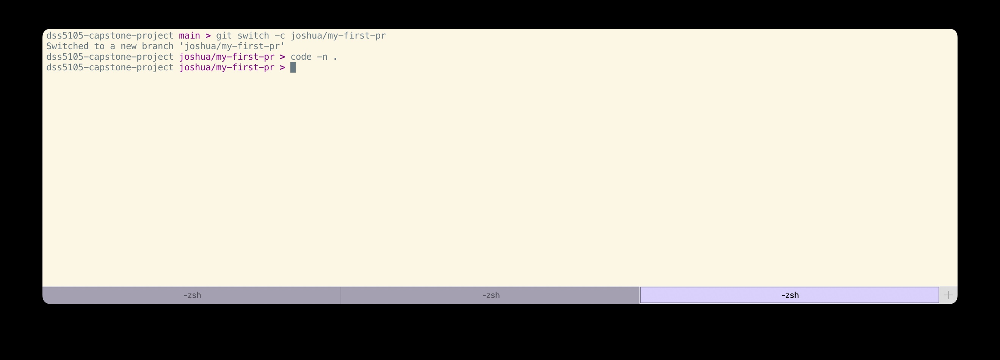

### Open `notebook/setup_check.py` using jupytext

For this, you need the [jupytext extension](https://marketplace.visualstudio.com/items?itemName=congyiwu.vscode-jupytext) as explained in the [reference below](#how-to-use-jupytext).

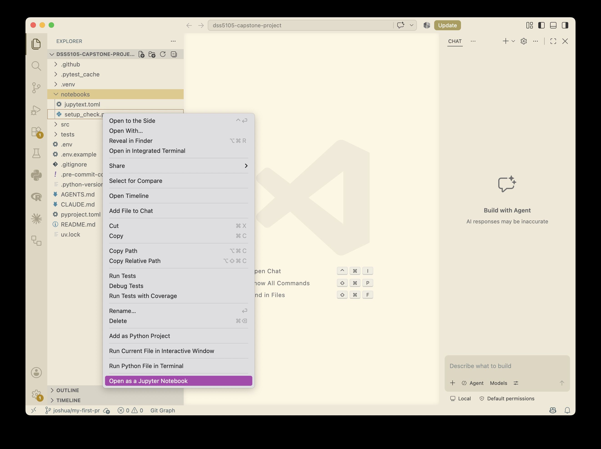

Alternatively, launch `jupyter lab` instead of VS Code:

```bash
uv run jupyter lab
```

and then open the notebook:

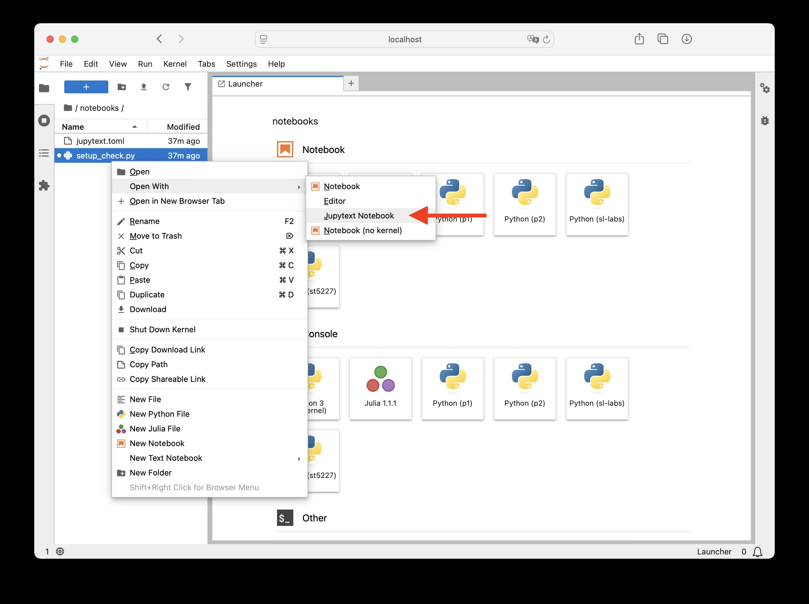

### Select the projects `.venv` kernel

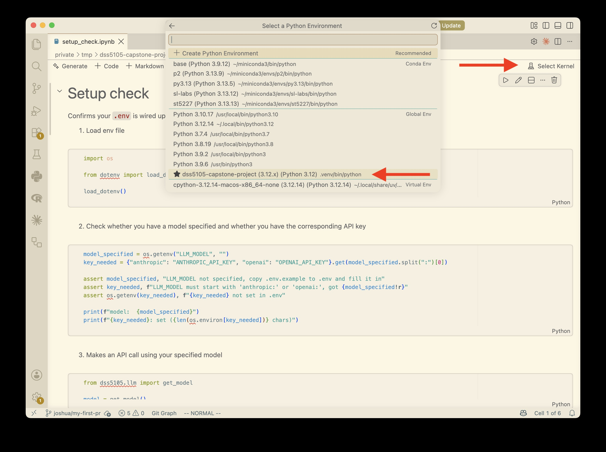

### Run the notebook to see whether your setup and API token works

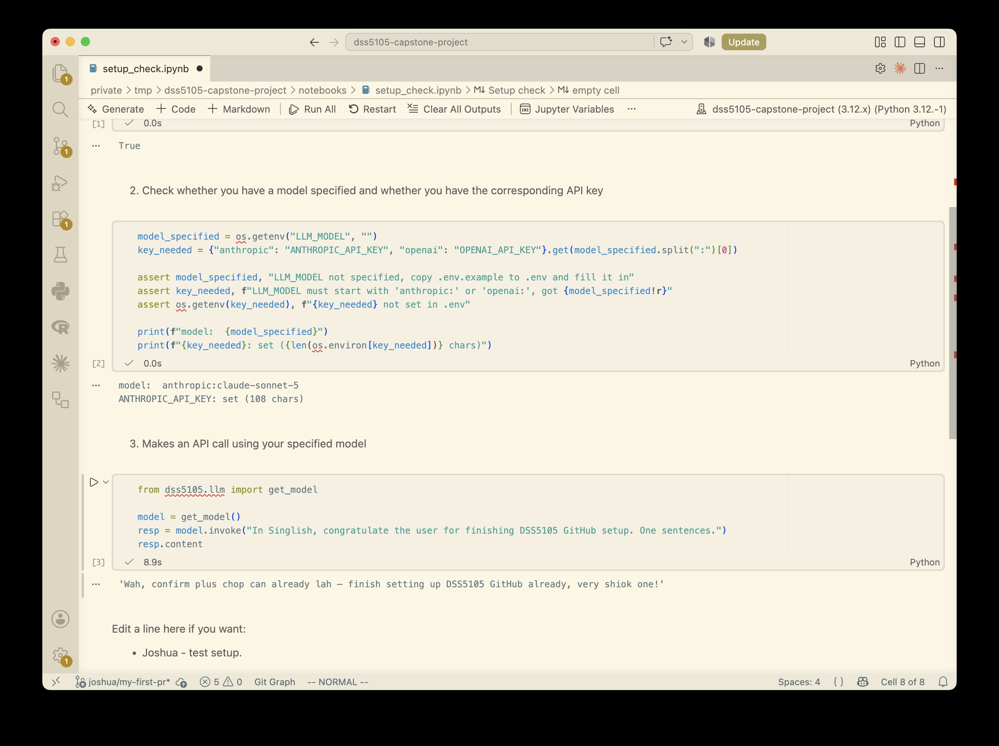

If you want, you can edit the last markdown line to cause a diff and raise a PR to try it out.

### Commit change

```bash
git add notebooks/setup_check.py # Only commit .py, not .ipynb.
git commit -m "Test PR and setup"
```

**If the commit is rejected, that's normal.** The hooks reformat your code and
stop the commit so you can see what changed. Look at the diff, then commit
again as shown in the screenshot:

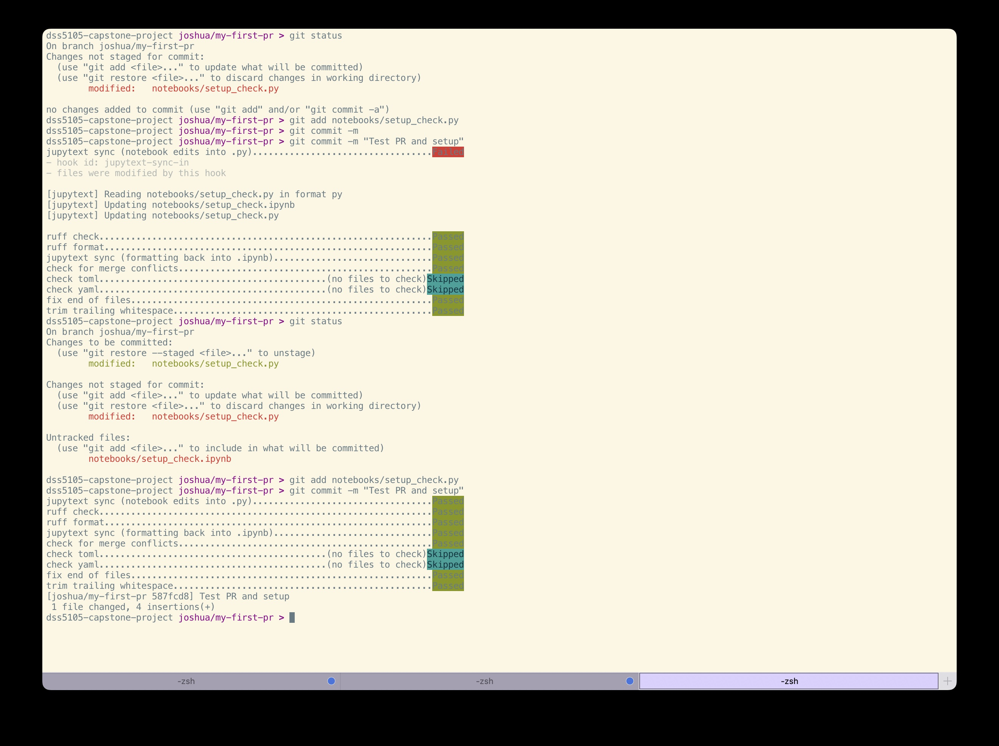

### Push and open a PR

```bash
git push origin your-name/short-description
```

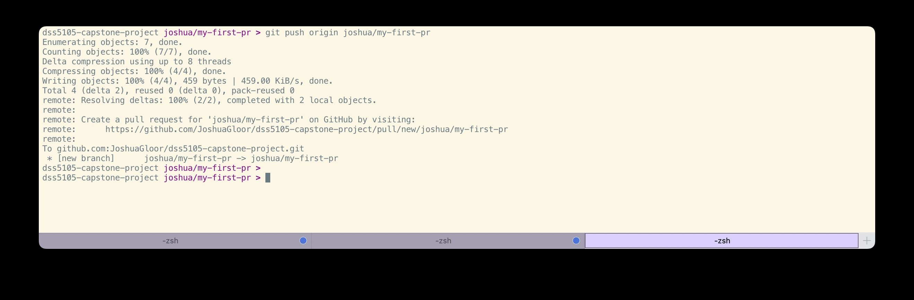

GitHub prints a link to open the PR. Or use the banner on the repo page.

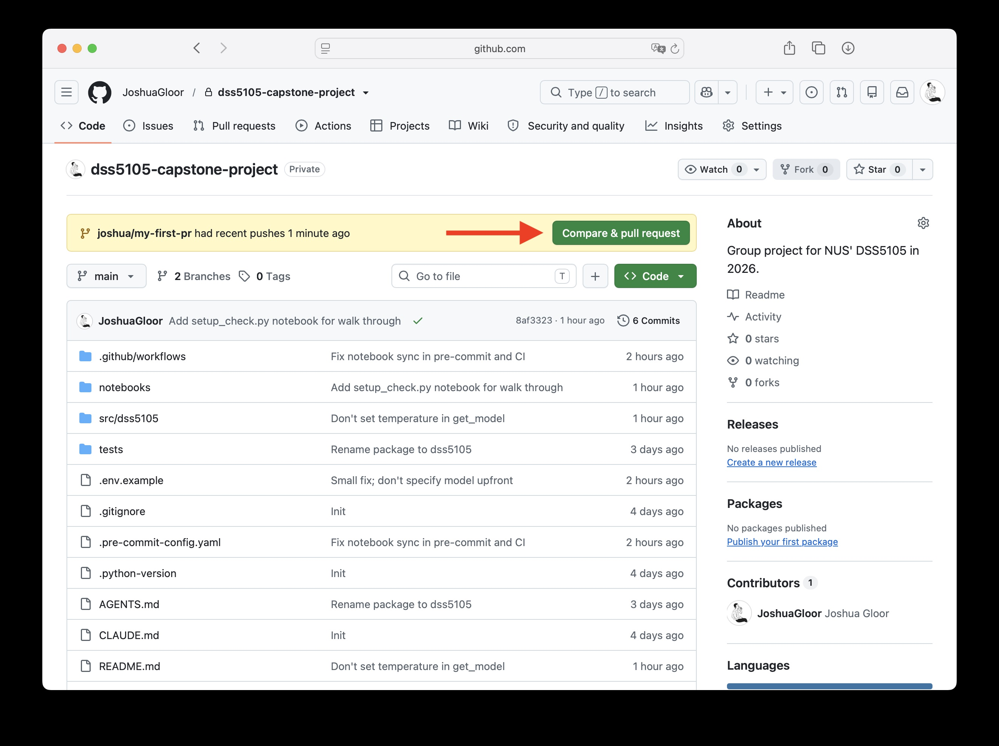

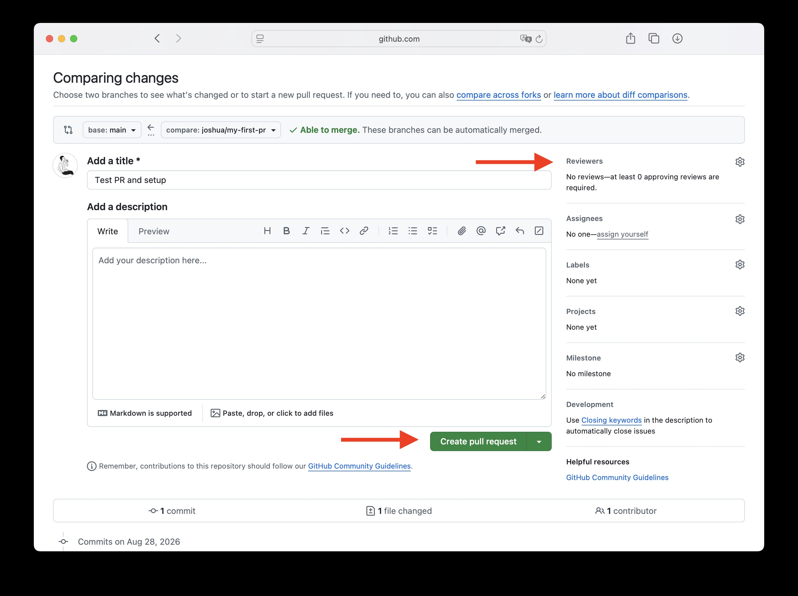

Some checks will run. Assuming they passed and you get at least one other team member to approve your PR, you can merge all your commits into `main` or squash them and merge a single commit:

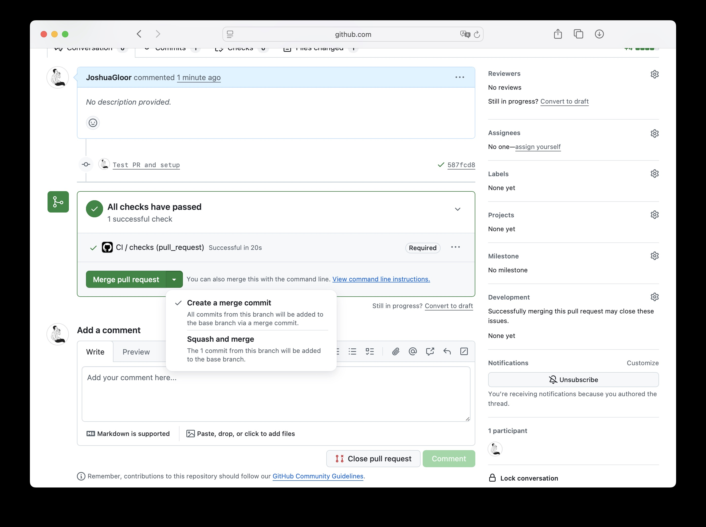

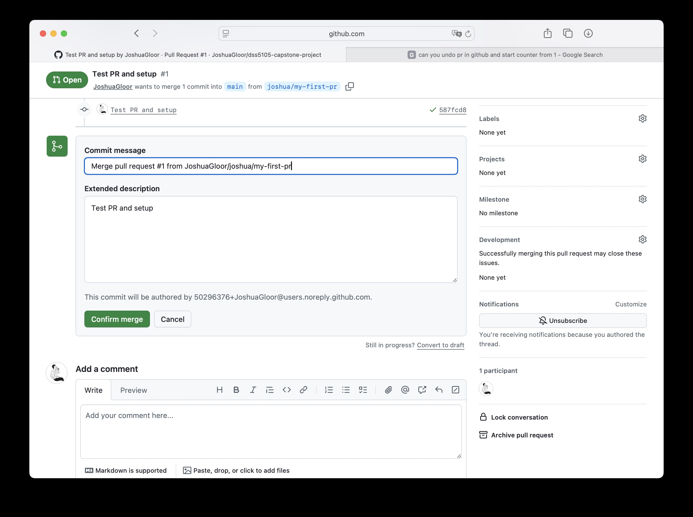

Then, you can delete the branch afterwards:

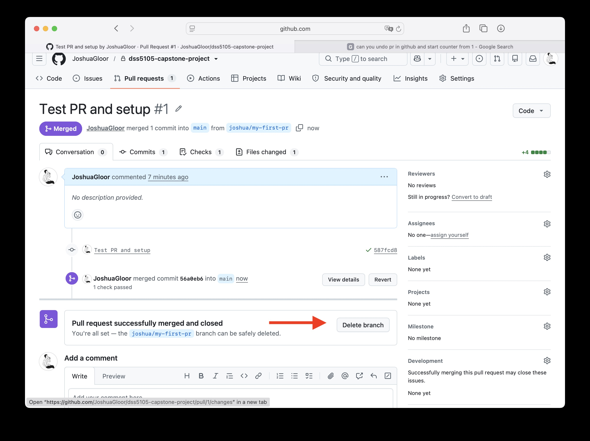

### Clean up local repo

Then, on your local, you can switch back to `main`, `pull`, and delete the branch you don't need anymore:

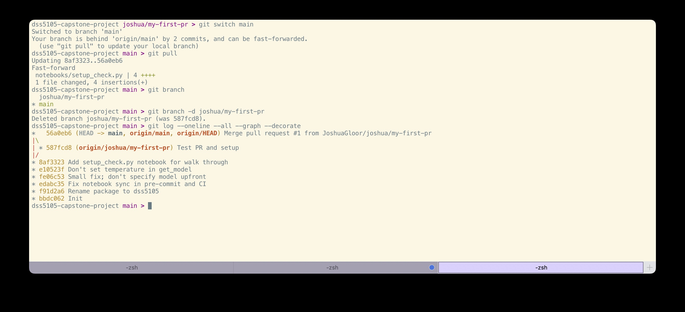

And you're done.

---

## Reference: how the repo keeps itself in sync

[README.md](README.md) lists what each file *is*. This part explains how the
environment, the keys, the two sets of checks and the notebook pairing actually
work, and what to do when one of them stops you.

### The environment: `pyproject.toml`, `uv.lock`, `.python-version`

These make sure we all have the same environment.
`uv sync` makes `.venv` match `uv.lock`.

**Adding a package:**

```bash
uv add <package-name>
```

This edits `pyproject.toml` *and* `uv.lock`. Commit both. If you forget the
lock file, CI fails: it runs `uv sync --locked`, which refuses to run when the
two have drifted apart.

### The code: `src/`, `tests/`

`src/dss5105/` holds the package, `tests/` holds its tests.

LangChain allows us to code in a vendor agnostic way.
Both classes, `ChatOpenAI` and `ChatAnthropic` are `BaseChatModel`s.
We can use [`init_chat_model`](https://reference.langchain.com/python/langchain/chat_models/base/init_chat_model) with the model string to take advantage of this.
`get_model()` in `llm.py` provides a simple wrapper for that: in our scripts we
call `get_model()` and it returns the model named by `LLM_MODEL` in `.env`. If
`LLM_MODEL` isn't set, it fails right away with a message telling you what to
fix, instead of breaking confusingly later.

We deliberately don't set `temperature`. Recent Anthropic models (Sonnet 5,
Opus 5 and newer) reject it with a 400, so passing it would break the default
provider. That means we can't dial in determinism that way, and identical
prompts can give slightly different answers.

We can use `llm.py` to add anything that is model related later as well.

**Recommendation:** we build models with `get_model()`, not `ChatAnthropic()`,
`ChatOpenAI()`, or `init_chat_model()` directly.

**Running tests:**

```bash
uv run pytest          # fast, free, no API calls
uv run pytest -m live  # really calls the provider, costs money
```

Anything that reaches a real provider needs `@pytest.mark.live`. Plain
`uv run pytest` skips those, and so does CI, so no PR ever spends tokens. When
a test does need a model, pass a fake one in (`FakeListChatModel`) rather than
importing the real thing, so it stays free and deterministic.

### Keys: `.env.example`, `.gitignore`

`.env.example` is the committed template: variable names, no values. `.env` is
your own copy with the real keys, and `.gitignore` keeps it out of git.

```bash
cp .env.example .env  # then paste in your own key
```

You only need the key for the provider you actually use.

**If a key does get committed**, revoke it in the provider console and generate
a new one. No need to panic, this repo is private.

### Commit-time checks: `.pre-commit-config.yaml`

These run automatically on `git commit`, against the files you staged.
As shown in [Setup your local copy](#1-setup-your-local-copy), you set them up as follows:

```bash
uv run pre-commit install  # once per person, per clone
```

What runs:

- **ruff** lints and formats our Python.
- A few cheap safety nets: catch leftover merge conflict markers, check that
  YAML and TOML still parse, and tidy up whitespace and end-of-file newlines.

**If a commit gets blocked, the hook has usually already fixed the file.** Look
at what changed, `git add` it, and commit again.

Run everything manually any time, without committing:

```bash
uv run pre-commit run --all-files
```

### PR-time checks: `ci.yaml`

Runs on every pull request to `main`, and on `main` itself:

1. **`uv sync --locked`** fails if `uv.lock` is stale
   (see [environment section](#the-environment-pyprojecttoml-uvlock-python-version)).
2. **`pre-commit run --all-files`** runs the exact same hooks as your machine,
   which also catches anyone who hasn't run `pre-commit install`.
3. **Notebook sync** re-runs `jupytext --sync` and fails if that produces a
   diff, so a committed `.ipynb` and its `.py` can't drift apart.
4. **`uv run pytest`** skips `live` tests by default (`addopts = "-m 'not live'"`),
   so a PR never spends tokens. CI also has no API keys, as a second line of defence.

### Notebooks: `notebooks/` and jupytext

We use [jupytext](https://jupytext.org) because `.ipynb` files are JSON
and their diffs are unreadable.
That means every notebook in `notebooks/` is paired with a `.py` "percent" twin. The
`.ipynb` is what you run, the `.py` is what git diffs and what is reviewable.

If you edit notebooks in JupyterLab, jupytext syncs the `.py` on save
automatically. In VS Code the same holds once you install the extension linked
in [How to use Jupytext](#how-to-use-jupytext); without it, nothing syncs on its own.
You can always trigger a sync manually:

```bash
uv run jupytext --sync notebooks/*.ipynb
```

**Recommendation: commit the `.py`, not the `.ipynb`.** The `.py` holds the full
source, so anyone can rebuild a runnable notebook from it:

```bash
uv run jupytext --sync notebooks/my_notebook.py  # recreates the my_notebook.ipynb
```

That keeps outputs and unreadable JSON diffs out of Git, and avoids bloating the repo.

**If we do decide to commit an `.ipynb` (e.g., fear of plots not being reproducible etc.),
it has to be in sync with its `.py`.**
CI checks exactly that and fails if the two disagree ([PR-time checks](#pr-time-checks-ciyaml)).

**Committing rewrites the notebook.** The commit hooks sync your edits into the
`.py`, let ruff format it, then write the result back into the `.ipynb`. So if
the notebook is open in Jupyter while you commit, reload it before carrying on.
Otherwise the stale buffer saves the old, unformatted source back over what the
hooks just did.

For the same reason, **edit one side at a time**. If both an `.ipynb` and its
`.py` change before a sync, jupytext keeps whichever was written last and
silently discards the other. Work in the notebook, or work in the script, and
sync in between.

#### How to use Jupytext

For a quick run, start JupyterLab with:

```bash
uv run jupyter lab
```

Right-click a `.py` file and select **Open With > Jupytext Notebook** to run it as a notebook.

For VS Code, install the
[jupytext extension](https://marketplace.visualstudio.com/items?itemName=congyiwu.vscode-jupytext)
and right-click the `.py` file and select **Open as a Jupyter Notebook**.
