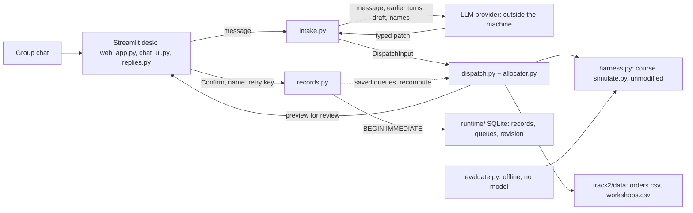

# Sprint 1 architecture and walkthrough

The [reviewed deck](slides/reviewed/Presentation_Group11_Sprint1.pptx) contains an
editable architecture diagram at module level: components, data flows, data stores and
the trust boundary. The [standalone SVG](sprint1-architecture.svg) shows the same system
at a higher level. The diagram describes the implemented local prototype. Language
accuracy, held-out evaluation and dispatcher usability remain unverified.

The model call in `intake.py` is the app's only outbound call. Locally the app binds to
127.0.0.1; on AWS it runs in a container behind Caddy with a password (see
`docs/DEPLOYMENT.md` on main). Streamlit telemetry is off in both. The model never
receives prices, queues or defect rates.

## Technical explanation for Q&A

This is one assistant workflow with deterministic Python orchestration. The LLM
extracts quoted request fields through LangChain structured output. It does not
choose tool calls autonomously, negotiate with other agents, or calculate estimates.
Python validates fields, resolves orders, preserves restrictions, asks clarification
questions and produces the displayed answer. `get_model()` reads the configured
`LLM_MODEL`; no model name is fixed in the architecture.

Session memory means Streamlit server-side session state: conversation turns,
draft fields, unresolved questions, provenance and extraction traces. It is ephemeral
and limited to the active conversation. We have no vector database, retrieval system,
long-term model memory or LangGraph graph in this implementation. Those components
should appear only if a future feature needs them.

In agent terms, this is a workflow agent: the track's "single well-tooled dispatcher".
The LLM and the tools run on a fixed code path, so the model never chooses a tool. We
chose this over a ReAct loop because every request needs the same checks in the same
order, and over a multi-agent design because the track says a plain dispatcher with
excellent tools beats a multi-agent conversation. The deck calls session state
short-term memory and the SQLite store long-term memory: the model keeps nothing between
turns, but Python resends the conversation each turn, and later previews read the saved
planning queues. Sprint 2 adds tool selection for read-only capacity questions only.

Confirmed decisions are a separate kind of state. SQLite stores reviewed evidence,
the dispatcher identity, state revision and updated planning queues. A transaction
rechecks the preview against current state. Unique order IDs and idempotency keys
protect against duplicate saves. The identity is self-declared, not authenticated.
The local plan does not book a real workshop or drain queues with wall-clock time.

The simulator calls the same allocator directly, without any LLM. It measures
allocation policy performance. Separate chat evaluation must measure extraction,
clarification, refusal and explanation accuracy. Fixture replay and offline tests
do not establish real language accuracy.

The new workshop-capacity workspace calls `query_register` and `probe_load` directly.
It estimates delivery for a hypothetical batch and shows the effect of more work
ahead of it. Those tools never reserve capacity. Natural-language routing for these
questions remains planned.

## Speaking scope

CHEN ZEPENG presents the opening, problem and architecture. Target speaking time
is 1 minute 50 seconds, leaving a buffer inside the allocated 2 minutes. The
[speaker script](slides/reviewed/Opening_Script_Group11.txt) also appears in
the deck's first three speaker-note pages. The remaining slides cover the objective,
business value, progress, risks and roadmap within the course's total presentation time.

The team has agreed on minimise lateness as the primary objective. The reviewed deck
declares "Primary objective: minimise lateness", measured by late fraction and mean
late days.

## Offline demonstration

Start with `sh scripts/run_app.sh`, then open the displayed local address in Chrome.
Choose **Supplied examples (offline, no model)** and **Independent previews**.

1. R25: a workshop exclusion remains in force when priorities change.
2. R08: the suggested workshop is refused with a reason and an alternative.
3. R03 or R05: missing details block a decision and prompt clarification.
4. R20: an impossible date shows estimates and options, with confirmation disabled.
5. **Workshop register (offline)**: check a batch against an explicit date,
   then compare delivery before and after extra work. The queues remain unchanged.
6. **Saved local plan**: review an on-time in-progress order, enter the dispatcher
   name and confirm. Show the saved record and changed planning queue.

Capacity updates only after dispatcher confirmation. Independent-mode confirmation
is a session demonstration and never saves an allocation.
