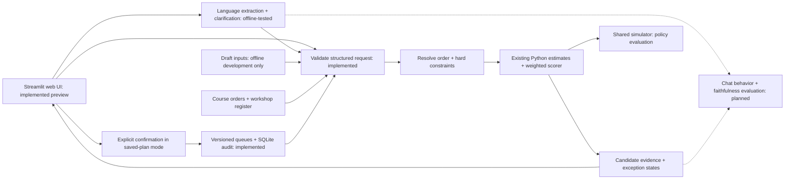

# Sprint 1 architecture and walkthrough

Use [the SVG](sprint1-architecture.svg) on a presentation slide. It is a standalone
vector image with a widescreen canvas; it can also be opened directly in a browser.
The diagram distinguishes implemented tools, the product prototype, and planned
language/state features. It is a target architecture with current status labels.
The language path is now implemented and tested with fake models; real-provider
the revised live evaluation is pending. Local durable confirmation is implemented;
held-out chat evaluation and full explanation review remain planned.
The Streamlit web interface now runs live Python previews with native controls.
The standalone HTML remains the design prototype and opens directly in Chrome.

## What to say about the design

The browser displays the Streamlit application. Streamlit calls the Python tools
directly; a separate frontend framework or REST service is not required for the
first version. The group-chat mode (the default) uses model-extracted, validated
patches and answer buttons; offline examples use fixtures. Keep conversational session state separate from durable allocations.

The language layer interprets what the dispatcher means and asks questions when
necessary. It does not calculate dates, costs, probabilities, or allocation scores.
Structured inputs cross a validation boundary into Python tools. Eligibility and
explicit exclusions are hard constraints; objective weights affect ranking only
inside the permitted set. The same scorer serves both the application and the
shared policy evaluation, while chat behavior has its own evaluation path.

Comparisons are previews on the same snapshot. Saved-plan mode commits only after
human confirmation and a current-state check, using SQLite transactions. Independent
previews and the HTML reference retain the demo-only confirmation interaction.

One well-tooled dispatcher agent is the starting design. No DeepAgents or multi-agent
architecture is required for this boundary. Add orchestration complexity only if
we can demonstrate its benefit on concrete cases.

## Proposed Sprint 1 story

The course format is five minutes plus two minutes of questions; this timing split
is our proposal, not an additional course rule.

| Time | Content |
|---|---|
| Opening minute | Factory chat problem, invalid workshop / missed-date risks, business value |
| Next minute | Declare primary and success criteria; show other/hybrid tradeoffs with retained evidence |
| Next minute | Architecture: language understands, tools calculate, dispatcher confirms |
| Next minute | Brief prototype walkthrough; identify implemented vs planned parts explicitly |
| Final minute | Evaluation plan, assumptions, risks, ownership and Sprint 2 roadmap |

The objective slide cannot be finalized until the team decides. Do not substitute
the prototype's default for a justified objective declaration.

## Rehearsable prototype path

1. Start on R25: the instruction excludes BudgetWorks. Switch lateness / defects /
   hybrid and inspect the tradeoff on identical queues. Show the exclusion evidence.
2. Select R08: FreshStart cannot accept the batch. Show the refusal reason and
   alternative without pretending it was automatically allocated.
3. Select R03 or R05: ambiguity or an unknown revised date blocks a recommendation.
4. Select R21: the request explicitly asks for cheapest while meeting the date.
   The request preference overrides global presets and filters infeasible candidates.
5. In Streamlit, switch to Saved local plan, review an on-time recommendation, enter
   the dispatcher name and confirm. Show the saved record and changed queue evidence.
   Independent mode and the standalone HTML still demonstrate confirmation only.

Use one or two cases if time is tight. R20 demonstrates an infeasible delivery date;
R13 demonstrates unavailable quote data. These are development fixtures, not a live
language-agent performance demonstration. All displayed numerical estimates are
generated by the same Python service used by the CLI.
